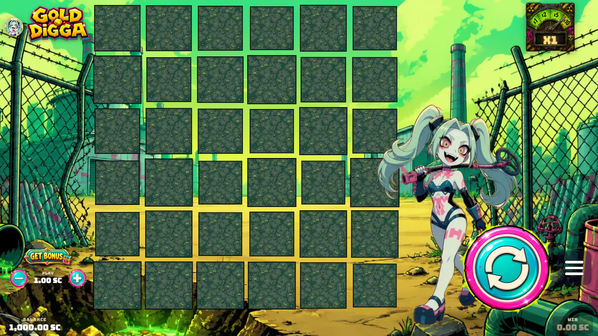

<div align="center">

# Gold Digga


**A Minesweeper-style dig-and-reveal game from [Spin Slaughter](https://stake.us/casino/games/spinslaughter-gold-digga).**
*Read the signal. Dig. Bank it.*

### Play Gold Digga

**[Play on Stake.us](https://stake.us/casino/games/spinslaughter-gold-digga) · [Play on Stake.com](https://stake.com/casino/games/spinslaughter-gold-digga)**

[All Spin Slaughter games](https://stake.us/casino/group/spin-slaughter) · [Source catalogue](https://github.com/chaosxcode/spin-slaughter) · [Ask me on X](https://x.com/SpinSlaughter)

</div>

---

## About

**Gold Digga** trades reels for a **dig-and-reveal grid** — a Minesweeper-inspired take on the slot. You **sweep a field**, uncover tiles, and read the **Signal** meter to decide how deep to push before you bank the dig. Uncover **Loot Chests** to earn extra sweeps (up to 22 in a bonus dig), and chase the feature digs — **The Big Dig**, **Night Dig**, and the guaranteed-hit **Deep Scan Sweep**, where the meter doubles.

It's a **social-casino** title — play is in Stake Cash / Gold Coins (`SC` / `GC`), no real-money wagering.

## Gameplay



## Game facts

| | |
|---|---|
| **Type** | Dig-and-reveal grid (Minesweeper-inspired) — Spin Slaughter's "Hoard Sweeper" engine |
| **Core loop** | Sweep tiles · read the **Signal** meter · collect multipliers · bank before trouble |
| **Bonus digs** | **The Big Dig** · **Night Dig** · **Deep Scan Sweep** (guaranteed hit, meter doubles) |
| **Loot Chests** | Award extra sweeps — up to **22** in a bonus dig |
| **RTP** | Tuned to the studio's 96.5% standard (all modes within the certification gate) |
| **Currency** | Social — `SC` / `GC` |
| **Studio** | Spin Slaughter |

## Tech

**Frontend** — TypeScript "Hoard Sweeper" engine (Vite), social-mode compliant, with an in-game rules/paytable/RTP guide.

**Math** — Python engine on the Stake Engine `math-sdk` (`games/sweeper`): server-authoritative outcomes, per-mode RTP validation with a tight cross-mode spread.

## Repository layout

```
frontend/   TypeScript "Hoard Sweeper" game source (hoardsweeper/)
math/        Stake Engine math-sdk model source (games/sweeper)
assets/      cover art
```

> **Note:** this repo holds **source only**. Built bundles, `node_modules`, Python virtualenvs,
> and the generated math data (multi-GB book/lookup files) are intentionally excluded — the
> live game runs on Stake's RGS.

---

<div align="center">
<sub>© Spin Slaughter. Gold Digga is a social-casino game published on Stake. This repository contains game source for reference; it is not a standalone playable build.</sub>
</div>


## Open source for the next builder

I'm sharing this frontend and math source because practical Stake game examples were hard to find when I started. I want the next beginner to have a real project to learn from.

If you enjoy the game, please share it. If the code helps, star the repo or send it to someone learning. Questions? Reach me on [@SpinSlaughter](https://x.com/SpinSlaughter); I'm happy to help where I can.
